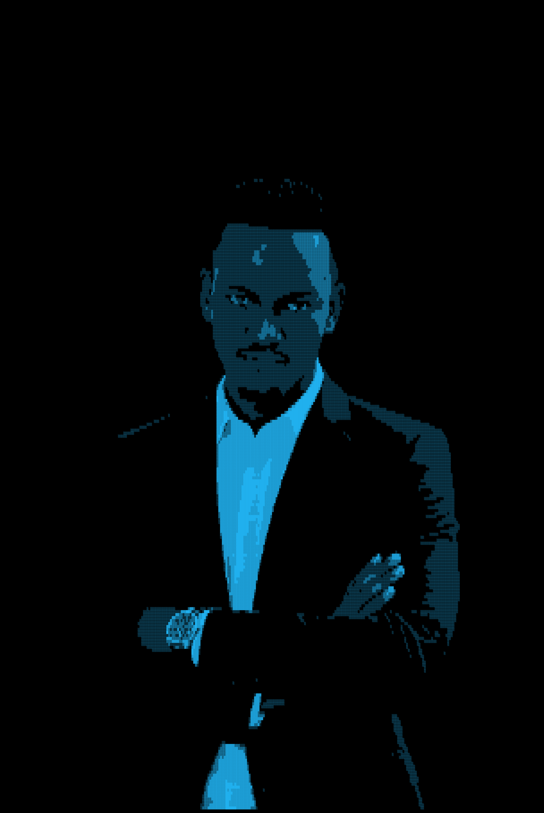

<!-- HEADER ANIME -->

  

  

<!-- BOUTON PORTFOLIO -->

  

<!-- NAVIGATION -->

  <a href="#a-propos">A propos</a> •
  <a href="#ce-que-je-fais">Ce que je fais</a> •
  <a href="#stack-technique">Stack</a> •
  <a href="#projets">Projets</a> •
  <a href="#statistiques-github">Stats</a> •
  <a href="#contact">Contact</a>

## A propos

> Je concois et developpe des **applications web**, **mobiles** et des **architectures backend performantes**.
> De la modelisation de bases de donnees a l'integration de modeles locaux ou a la conteneurisation, je privilegie des solutions maintenables et pragmatiques.

- Etudiant en **Genie Logiciel** a l'**INTEC-SUP**
- Oriente **Clean Architecture**
- Experimentation avec des **LLM locaux** dans mes workflows de developpement
- Base en Afrique de l'Ouest, ouvert aux collaborations a distance

## Ce que je fais

<table>
  <tr>
    <td width="50%" valign="top">
      <h3>Backend &amp; Mobile</h3>
      Architectures structurees (<i>Clean Architecture</i>, DDD) avec <b>Java (Spring Boot)</b>, <b>PHP (Laravel)</b> et <b>Dart (Flutter / Riverpod)</b>.
    </td>
    <td width="50%" valign="top">
      <h3>UI/UX &amp; Prototypage</h3>
      Interfaces prototypees sur <b>Figma</b> et integrees avec <b>Livewire</b> et <b>Blade</b>.
    </td>
  </tr>
  <tr>
    <td width="50%" valign="top">
      <h3>DevOps &amp; Donnees</h3>
      Services conteneurises avec <b>Docker</b>, scripts et workflows sous macOS/Linux, bases <b>MySQL</b> et <b>PostgreSQL</b>.
    </td>
    <td width="50%" valign="top">
      <h3>IA &amp; Outils Dev</h3>
      Integration de modeles locaux (<b>Ollama</b>, <b>LM Studio</b>) et outils d'analyse/assistance au developpement.
    </td>
  </tr>
</table>

## Stack Technique

<b>Langages &amp; Frameworks</b>

 

  
  
  
  
  
  
  
  

<b>Bases de Donnees &amp; DevOps</b>

 

  
  
  
  

<b>Environnement &amp; Outils</b>

 

  
  
  
  
  

## Projets

| Projet | Description | Tech Stack |
| :--- | :--- | :--- |
| **MaliServices** | Plateforme de services web : analyse des besoins, architecture API et design UI. | `Laravel` `Figma` `REST API` |
| **FermePro** | Suivi et gestion des operations agricoles et des stocks. | `Laravel` `Livewire` `MySQL` |
| **ProjectLens & LogLens** | Analyse de code (AST) et traitement de logs avec assistance IA locale. | `Java` `Flutter` `LLM locaux` |
| **Cash-Flow** | Gestion financiere structuree selon la *Clean Architecture*. | `Flutter` `Riverpod` `Dart` |

  

## Statistiques GitHub

  
  

  

  

## Contact

  <em>Un projet, une idee ou une collaboration ? Echangeons.</em>

  
  
  

> *« Le bon code est sa propre meilleure documentation. »*

